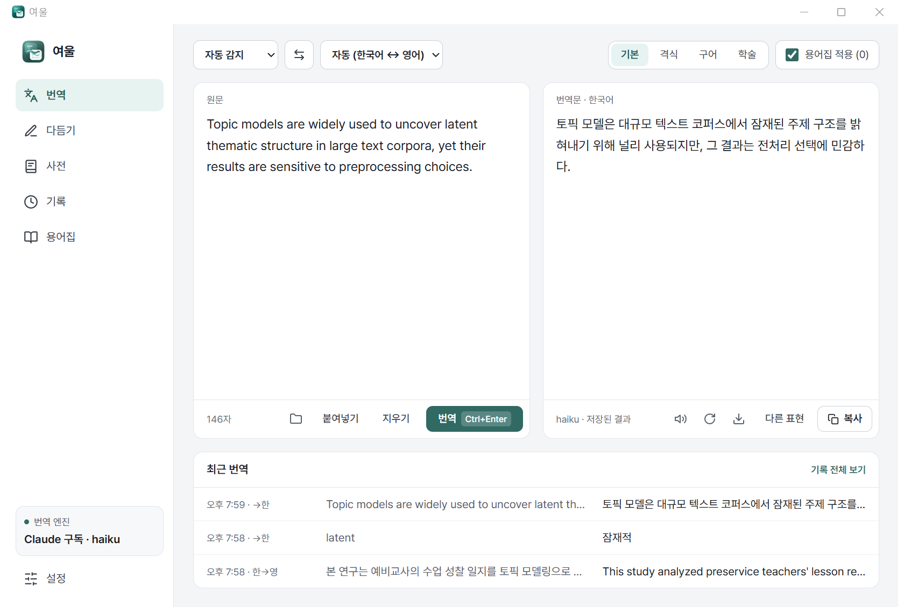
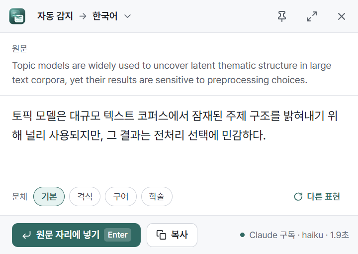
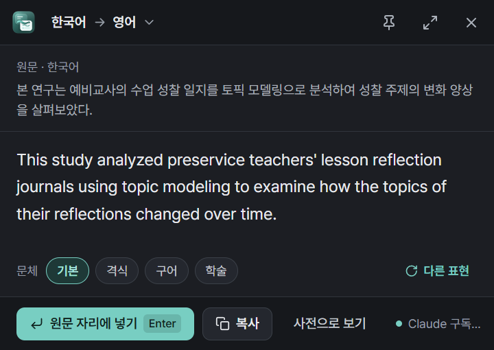
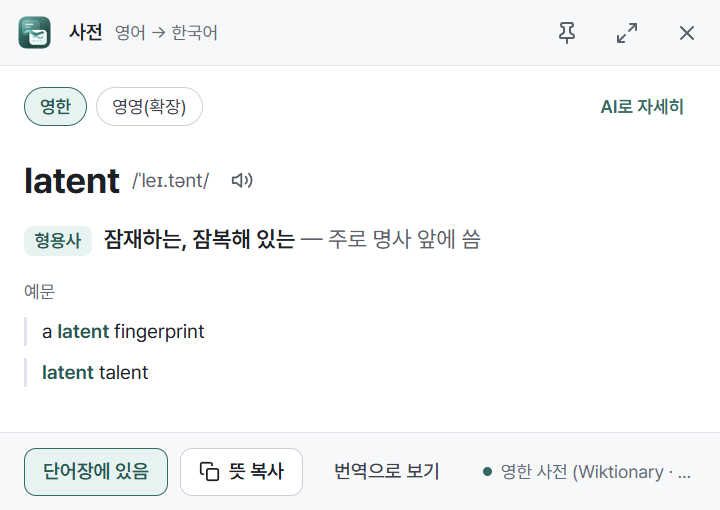
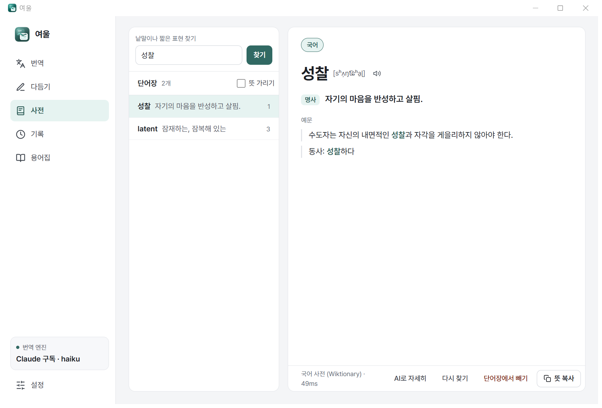
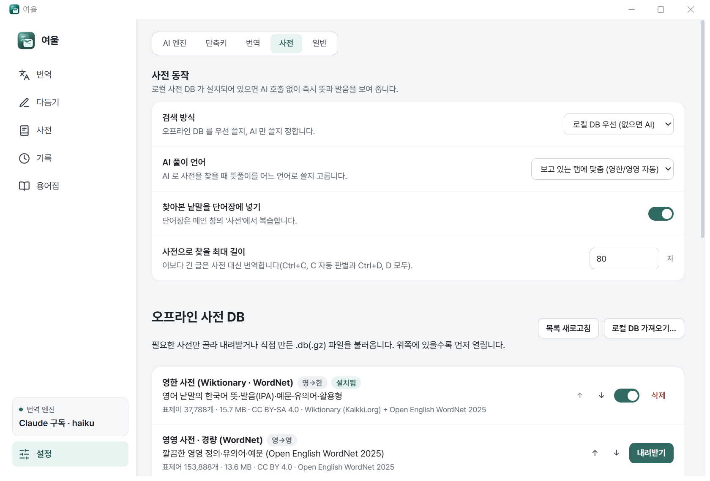
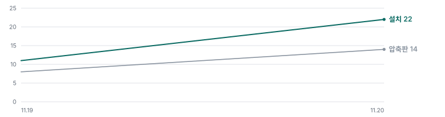

# 여울 (Yeoul) — 내 구독 AI로 번역하는 Windows 빠른 번역기

**여울(Yeoul)**은 이미 쓰고 있는 구독 AI(Claude, ChatGPT/Codex, Google Antigravity)나 API 키·로컬 모델로 번역과 사전을 한 번에 쓰는 Windows 빠른 번역기입니다. 어느 프로그램에서든 글을 선택하고 **`Ctrl+C, C`** 를 누르면 커서 옆 작은 창에 바로 결과가 뜹니다.

문장은 번역으로, 낱말이나 짧은 표현은 사전으로 알아서 나누어 줍니다. 오프라인 사전 DB 를 내려받아 두면 AI 를 부르지 않고도 **1~3ms 만에** 뜻과 발음을 볼 수 있습니다. Windows 10·11용이며 무료입니다.

> ‘여울’은 물살이 빠르고 얕아 건너기 좋은 곳을 뜻하는 우리말입니다. 말과 말 사이를 빠르게 건넌다는 뜻으로 붙였습니다.

 &nbsp; 

[최신 판 받기](https://github.com/dodaseo/yeoul-releases/releases/latest) · [오프라인 사전 팩](https://github.com/dodaseo/yeoul-releases/releases/tag/dicts-v1) · [이용 조건](LICENSE) · [문제 제보 · 제안](https://github.com/dodaseo/yeoul-releases/issues/new)

## 내려받기

[Releases](https://github.com/dodaseo/yeoul-releases/releases/latest)에서 **`Yeoul-<버전>-setup.exe`** 를 받아 실행합니다.

- 사용자별 설치라 관리자 권한이 필요 없습니다(`%LOCALAPPDATA%\Programs\Yeoul`). 다시 설치하면 떠 있는 여울을 끝내고 설정·기록·단어장·용어집·사전 팩을 그대로 둔 채 덮어씁니다.
- 설치 없이 쓰려면 `Yeoul-<버전>-portable.zip` 을 풀어 `Yeoul.exe` 를 실행합니다.
- 처음 실행할 때 「Windows의 PC 보호」(SmartScreen) 안내가 뜨면 **추가 정보 → 실행**을 누르세요. 코드 서명 전이라 나타나는 안내이며, 함께 올린 `SHA256SUMS.txt` 로 파일 무결성을 확인할 수 있습니다.
- 새 판이 나오면 백그라운드에서 확인해 SHA-256 검증 뒤 앱 안에서 바로 업데이트합니다(설치판·압축판 모두 지원).

| | |
|---|---|
| 운영체제 | Windows 10 · 11 (64비트) |
| 런타임 | Microsoft Edge WebView2 (Windows 11 기본 포함, Windows 10 은 없으면 설치 프로그램이 안내) |
| 번역 엔진 | 구독 AI(Claude · ChatGPT/Codex · Google Antigravity — 앱 안에서 원클릭 설치·로그인 안내), API 키, 또는 로컬 모델(Ollama · LM Studio) |
| 오프라인 사전 | AI·인터넷 없이 단독 동작 (**설정 › 사전** 에서 원하는 사전 팩만 선택 설치) |

## 하는 일

### 어디서나 Ctrl+C, C — 빠른 번역

- 브라우저·PDF·워드·한글(HWP)·메모장 등 어느 프로그램에서든 글을 선택하고 **`Ctrl` 을 누른 채 `C` 를 두 번**(1초 안) 누르면 커서 옆 작은 창에 번역이 바로 뜹니다.
- 번역 방향은 자동입니다. 내 언어(기본 한국어)로 쓴 글은 상대 언어(기본 영어)로, 그 밖의 언어는 내 언어로 옮깁니다.
- 작은 창에서 문체(**기본 · 격식 · 구어 · 학술**)를 바꾸거나 **다른 표현** 세 가지를 비교해 고를 수 있고, **`Enter`** 로 원문 자리에 바로 넣거나 **`Ctrl+C`** 로 복사합니다.
- 라이트·다크 테마(Windows 설정 따르기 포함)를 지원합니다.

### 낱말은 알아서 사전으로 — 오프라인 사전 DB와 단어장

- 같은 **`Ctrl+C, C`** 하나로 낱말·짧은 표현(띄어 쓰는 말은 세 낱말까지, 설치한 사전에 있는 숙어는 여섯 낱말까지)은 사전으로, 문장은 번역으로 알아서 엽니다.
- 잘못 골랐으면 작은 창에서 **`Ctrl+D`** (또는 **사전으로 보기 / 번역으로 보기**)로 바로 바꿉니다. 사전을 별도 단축키로만 열고 싶다면 **설정 › 단축키**에서 `Ctrl+D, D` 를 따로 켤 수도 있습니다.
- **설정 › 사전** 에서 오프라인 사전 DB 팩을 내려받아 두면 **AI 호출 없이 1~3ms 만에** 발음(영어 IPA · 국어 표준 발음 · 일본어 읽기), 품사별 뜻풀이, 예문과 유의어를 바로 보여 줍니다.
- 여러 사전이 설치되어 있으면 우선순위 순으로 결과 있는 사전만 탭(`←` / `→`)으로 표시하며, 메인 창에서는 **`[전체 비교]`** 로 나란히 비교할 수 있습니다.
- 영어 활용형(`analyses` · `went` · `stopped`), 한국어 조사·어미(`성찰을` · `성찰했다`), 틀린 철자 교정, 동음이의어·한자를 지원합니다. DB 에 없는 숙어나 뉘앙스 비교가 필요할 때만 **`[AI로 자세히]`** 를 눌러 보고 있는 탭 언어(영한·영영·국어)에 맞춘 AI 풀이를 덧보여 줍니다(설정에서 `로컬 DB만` 사용도 가능).
- 찾아본 낱말은 메인 창 **단어장**에 자동으로 쌓이며, 찾은 횟수 기록과 **뜻 가리기** 복습을 지원합니다.

**설정 › 사전** 에서 원하는 사전 팩만 골라 원클릭(SHA-256 검증)으로 내려받거나, 국립국어원 XML 등으로 직접 변환한 `.db`/`.db.gz` 파일을 **로컬 DB 가져오기…** 로 등록할 수 있습니다.

| 사전 팩 | 언어 | 수록 내용 | 표제어 수 | 라이선스 |
|---|---|---|---|---|
| **영한 사전** | 영 → 한 | Wiktionary + WordNet 보강 (IPA·예문·유의어·활용형) | 37,788개 | CC BY-SA 4.0 |
| **영영 사전 · 경량** | 영 → 영 | Open English WordNet 2025 (정의·유의어·예문) | 153,888개 | CC BY 4.0 |
| **영영 사전 · 확장** | 영 → 영 | English Wiktionary (학술어·구동사·IPA·활용형) | 862,680개 | CC BY-SA 4.0 |
| **국어 사전** | 국 → 국 | Korean Wiktionary (표준 발음·품사·뜻풀이·유의어) | 68,290개 | CC BY-SA 4.0 |
| **한영 사전** | 국 → 영 | Wiktionary 한영 대역·발음·예문 | 51,714개 | CC BY-SA 4.0 |
| **일한 사전** | 일 → 한 | Korean Wiktionary 일본어 뜻·발음·활용형 | 12,247개 | CC BY-SA 4.0 |
| **중한 사전** | 중 → 한 | Korean Wiktionary 중국어 낱말·한자 뜻풀이 | 15,913개 | CC BY-SA 4.0 |

### 긴 글 번역 · 글 다듬기 · 용어집

- 작은 창에서 **`Ctrl+E`** 를 누르거나 일정 길이(기본 5,000자, 설정에서 변경)를 넘는 글을 번역하면 메인 창으로 이어집니다.
- 6,000자를 넘는 긴 글은 문단 경계에서 나누어 차례로 번역하고, 문단 누락이나 미번역이 의심되면 한 번 다시 시도한 뒤 알려 줍니다.
- **글 다듬기**로 같은 언어 안에서 문장을 매끄럽게 고치고, **용어집**에 전공 용어나 고유 명사를 등록해 항상 일관된 표현으로 옮길 수 있습니다.
- **기록** 검색, 텍스트 파일 열기·저장, Windows 음성 읽어 주기(🔊)를 지원합니다.

### 이미 쓰는 구독 AI · API · 로컬 모델 그대로

- 별도 유료 번역 구독 없이 이 PC 에 로그인해 둔 **Claude**, **ChatGPT (Codex)**, **Google Antigravity** 구독을 그대로 연결합니다.
- 명령줄 도구(CLI)를 써 본 적이 없어도 첫 화면 온보딩이나 **설정 › AI 엔진**에서 클릭 한 번으로 공식 CLI 설치·로그인·업데이트를 진행할 수 있습니다.
- **OpenAI 호환 API**(OpenAI · OpenRouter · Ollama · LM Studio 등), **Anthropic API**, **Gemini API** 도 지원하며, **실패하면 다른 엔진으로**를 켜 두면 한도 초과나 오류 때 대체 엔진으로 자동 전환합니다.

| 엔진 | 특징 |
|---|---|
| **Claude 구독** | 프로세스 미리 준비로 첫 글자 약 0.8초, 한 문장 1.5~2.5초 실시간 스트리밍 |
| **ChatGPT 구독 (Codex)** | 공식 CLI 연동, 원문만 표준 입력으로 전달하는 읽기 전용 실행 |
| **Google 구독 (Antigravity)** | 상주 서버 미리 준비로 한 문장 약 2.5~3.7초, 도구·MCP 격리 실행 |
| **API 키 · 로컬 모델** | OpenAI 호환(Ollama · LM Studio 포함) · Anthropic · Gemini 직접 스트리밍 |

## 빠른 시작과 단축키

| 단계 | 내용 |
|---|---|
| ① 설치 | `Yeoul-<버전>-setup.exe` 를 실행해 설치합니다. 처음 실행하면 애니메이션 튜토리얼이 핵심 조작을 안내합니다 |
| ② 엔진 연결 | 첫 화면 온보딩 또는 **설정 › AI 엔진**에서 구독 AI(Claude · Codex · Antigravity)를 원클릭 설치·로그인하거나 API 키·로컬 모델을 고릅니다 |
| ③ 사전 팩 설치 (선택) | **설정 › 사전**에서 자주 쓰는 오프라인 사전 팩(영한·영영·국어 등)을 내려받으면 AI 대기 시간 없이 즉시 사전이 동작합니다 |
| ④ 어디서나 번역 · 사전 | 어느 프로그램에서든 글을 고르고 **`Ctrl+C, C`** — 문장은 번역, 낱말은 사전으로 열립니다 |

| 하고 싶은 일 | 단축키 · 조작 |
|---|---|
| 선택한 글 바로 번역 · 낱말 사전 | `Ctrl+C, C` (`Ctrl` 을 누른 채 `C` 두 번, 1초 안) — 문장은 번역, 낱말·짧은 표현은 사전으로 자동 판별 |
| 사전 ↔ 번역 바꾸기 | 작은 창에서 `Ctrl+D` (또는 **사전으로 보기 / 번역으로 보기**) |
| 번역문을 원문 자리에 넣기 | 작은 창에서 `Enter` 또는 `Ctrl+R` |
| 번역문 · 뜻 복사 | 작은 창에서 `Ctrl+C` |
| 번역할 언어 바꾸기 | 작은 창에서 `Space` |
| 사전 탭 좌우 전환 | 작은 창 사전에서 `←` / `→` |
| 메인 창에서 이어서 작업 | 작은 창에서 `Ctrl+E` |
| 작은 창 닫기 | `Esc`, 또는 바깥 클릭 (고정 핀으로 유지 가능) |
| 메인 창에서 번역 · 다듬기 실행 | `Ctrl+Enter` |

- DeepL 처럼 `Ctrl+C, C` 를 쓰는 다른 프로그램과 단축키가 겹치면 한쪽 단축키를 끄거나 **설정 › 단축키**에서 다른 조합으로 바꿀 수 있습니다. 특정 프로그램(게임·엑셀 등)에서만 단축키를 무시하도록 예외 목록을 둘 수도 있습니다.

## 데이터와 이용 조건

- **설정 · 번역 기록 · 단어장 · 용어집 · 사전 DB · API 키는 모두 이 PC 에만 저장됩니다**(`%LOCALAPPDATA%\Yeoul`, OneDrive 동기화 제외, 앱을 제거해도 남음).
- API 키는 Windows DPAPI(현재 사용자 계정)로 암호화해 보관합니다.
- 오프라인 사전 조회는 네트워크를 전혀 쓰지 않습니다. 번역·AI 사전 요청 시에만 사용자가 고른 엔진으로 원문이 전송됩니다.
- 이 저장소는 공개 배포 전용 저장소(설치본·압축판·체크섬·오프라인 사전 팩·이슈)이며 소스 코드는 비공개 저장소에 있습니다. 이용 조건은 [LICENSE](LICENSE) 를 따릅니다.
- 문제 제보나 기능 제안은 [Issues](https://github.com/dodaseo/yeoul-releases/issues/new) 에 남겨 주세요.

## 준비 중

일정은 확정이 아니며 순서나 방식이 바뀔 수 있습니다.

| 항목 | 내용 |
|---|---|
| 화면 글자 번역 (OCR) | 화면 영역을 잡으면 Windows 내장 OCR 로 글자를 읽어 작은 창에서 번역·사전으로 엽니다 (이미지·스캔 PDF·영상 자막용) |
| 크롬 확장 | 웹페이지에서 선택한 글 옆 말풍선 번역·사전. 앱의 번역 엔진·오프라인 사전 DB·단어장을 그대로 함께 씁니다 |
| 문서 번역 (.docx) | 문단·표·서식을 유지한 채 번역해 새 파일로 저장합니다 (긴 글 나누기와 용어집 재사용) |
| 단어장 복습 | 단어장에 쌓인 낱말로 플래시카드와 간격 반복 복습을 지원합니다 |

## 자매 제품

- **[Ibis](https://github.com/dodaseo/ibis-releases)** — 한국 연구자를 위한 문헌 관리 · 한글/Word 본문 인용
- **[에믹 (Emic)](https://github.com/dodaseo/emic-releases)** — 한국어 질적분석 스튜디오

## 사용 현황

<!-- DL-STATS:START -->
<!-- 이 블록은 .github/workflows/dl-stats.yml 이 매일 생성합니다. 직접 고치지 마세요. -->

최신 기록 **2026-11-24** · 앱 누적 **36건** (설치 22 · 압축판 14) · 오프라인 사전 팩 **21건**

<picture>
  <source media="(prefers-color-scheme: dark)" srcset="stats/downloads-dark.svg">
  
</picture>

> 설치판과 압축판 모두 앱 안 자동 업데이트가 해당 파일을 내려받으므로, 신규 설치와 업데이트가 함께 잡힙니다.

자세한 표는 [stats/README.md](stats/README.md), 원본은 [stats/downloads.csv](stats/downloads.csv).

<!-- DL-STATS:END -->
