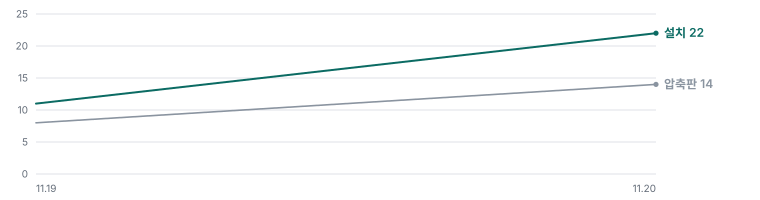
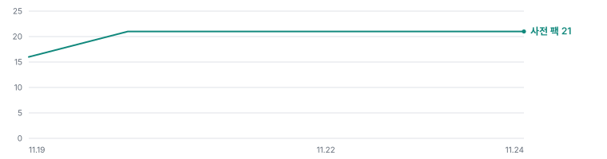

# 다운로드 추이

- 기록 시작 **2026-11-19** · 최신 스냅숏 **2026-11-26** · 스냅숏 8개
- 이 파일은 매일 자동 생성됩니다. 원본은 [`downloads.csv`](downloads.csv) · [`repo.csv`](repo.csv).

## 누적

| 구분 | 누적 | 전일 대비 |
|---|---:|---:|
| 설치 프로그램 (`setup.exe` — 새 설치 + 설치판 자동 업데이트) | 22 | 0 |
| 무설치 압축판 (`portable.zip` — 무설치 + 압축판 자동 업데이트) | 14 | 0 |
| **앱 내려받기 소계** | **36** | **0** |
| 오프라인 사전 팩 (`*.db.gz`) | 21 | 0 |
| 사전 카탈로그 (`manifest.json` — 설정 › 사전 목록 조회) | 10 | 0 |
| 체크섬 (`SHA256SUMS.txt` — 업데이트 검증 등) | 24 | 0 |
| 기타 (`LICENSES-DICTS.txt` 등) | 1 | 0 |
| **전체 자산 합계** | **92** | **0** |

- 여울의 인앱 자동 업데이트(`updater.py`)는 설치판에서는 `-setup.exe`, 무설치 압축판에서는 `-portable.zip` 을 내려받으므로 두 항목 모두 신규 다운로드와 자동 업데이트가 함께 집계됩니다.
- 배포 스크립트(`publish.ps1`)가 새 릴리스를 올린 직후 체크섬 검증을 위해 자산을 1회 내려받으므로 릴리스 직후 초기 +1건이 포함됩니다.
- `SHA256SUMS.txt` 는 업데이트를 실제로 내려받을 때만 받으므로(단순 최신 버전 확인은 API 조회만 수행) 일별 실행 횟수 지표로 쓰지 않습니다.
- `manifest.json` 은 앱의 **설정 › 사전** 카탈로그를 새로고침할 때 내려받습니다.

## 저장소 현황

| 항목 | 현재 | 전일 대비 |
|---|---:|---:|
| 스타 (Stars) | 0 | 0 |
| 포크 (Forks) | 0 | 0 |
| 워처 (Watchers) | 0 | 0 |
| 열린 이슈 (Open Issues) | 0 | 0 |

## 누적 그래프

<picture>
  <source media="(prefers-color-scheme: dark)" srcset="downloads-dark.svg">
  
</picture>

> 설치판과 압축판 모두 앱 안 자동 업데이트가 해당 파일을 내려받으므로, 신규 설치와 업데이트가 함께 잡힙니다.

<picture>
  <source media="(prefers-color-scheme: dark)" srcset="dicts-dark.svg">
  
</picture>

> **설정 › 사전** 에서 원클릭으로 내려받은 오프라인 사전 DB 팩(`*.db.gz`) 누적 건수입니다.

## 일별 증가

| 날짜 | 설치 | 압축판 | 앱 합계 | 사전 팩 |
|---|---:|---:|---:|---:|
| 2026-11-20 | +11 | +6 | +17 | +5 |
| 2026-11-21 | +0 | +0 | +0 | +0 |
| 2026-11-22 | +0 | +0 | +0 | +0 |
| 2026-11-23 | +0 | +0 | +0 | +0 |
| 2026-11-24 | +0 | +0 | +0 | +0 |
| 2026-11-25 | +0 | +0 | +0 | +0 |
| 2026-11-26 | +0 | +0 | +0 | +0 |

## 릴리스별 (최신 스냅숏)

| 릴리스 | 설치 | 압축판 | 합계 |
|---|---:|---:|---:|
| v0.1.8 | 5 | 2 | 7 |
| v0.1.3 | 3 | 3 | 6 |
| v0.1.7 | 3 | 2 | 5 |
| v0.1.6 | 3 | 2 | 5 |
| v0.1.5 | 3 | 2 | 5 |
| v0.1.4 | 2 | 2 | 4 |
| v0.1.2 | 3 | 1 | 4 |

## 오프라인 사전 팩별 (최신 스냅숏)

| 사전 팩 | 파일 | 누적 | 전일 대비 |
|---|---|---:|---:|
| 영한 사전 | `en-ko.db.gz` | 5 | 0 |
| 영영 사전 · 확장 | `en-en-wikt.db.gz` | 4 | 0 |
| 한영 사전 | `ko-en-wikt.db.gz` | 4 | 0 |
| 국어 사전 | `ko-ko-wikt.db.gz` | 3 | 0 |
| 영영 사전 · 경량 | `en-en-oewn.db.gz` | 2 | 0 |
| 일한 사전 | `ja-ko.db.gz` | 2 | 0 |
| 중한 사전 | `zh-ko.db.gz` | 1 | 0 |

- 사전 카탈로그(`manifest.json`) 누적 조회: **10건** (전일 대비 0)

